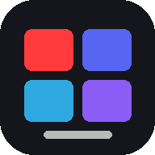
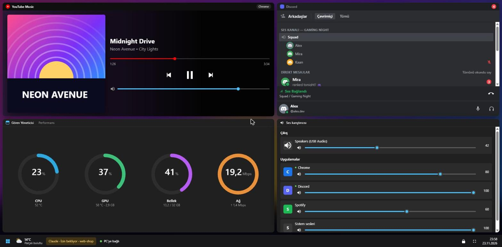
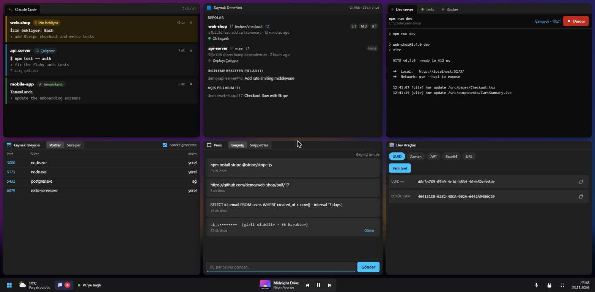
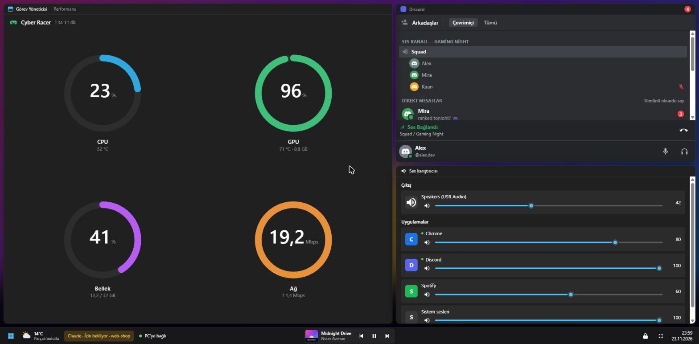
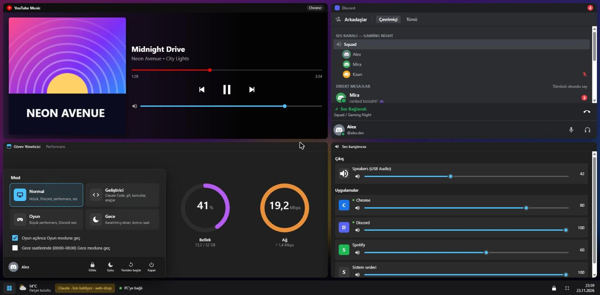
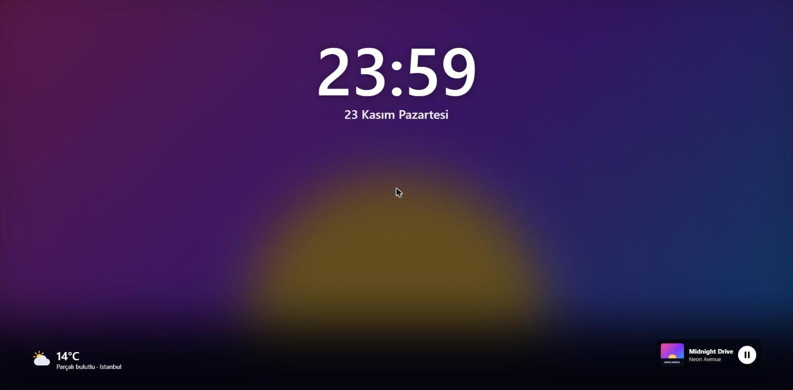

<div align="center">



<h1>MiniDesktop</h1>

<p><b>Turn any tablet into a second, touch-friendly mini desktop for your Windows PC.</b><br>
Media controls · Discord friends &amp; mic · live CPU/GPU stats · Claude Code &amp; developer dashboard · game mode</p>

<p>
  <a href="https://github.com/asimbakii/MiniDesktop/releases/latest"></a>
  <a href="LICENSE"></a>
  
  
  <a href="https://github.com/asimbakii/MiniDesktop/stargazers"></a>
</p>

<p>
  <a href="#-download--install"><b>Download</b></a> ·
  <a href="#-features">Features</a> ·
  <a href="#-screenshots">Screenshots</a> ·
  <a href="#-compatible-tablets">Compatible tablets</a> ·
  <a href="#-how-it-works">How it works</a> ·
  <a href="#-build-from-source">Build</a> ·
  <a href="docs/README.tr.md">Türkçe</a>
</p>



</div>

<br>

> **What is MiniDesktop?** A free, open-source **second screen / control panel** for Windows. Install it on your PC, scan a QR code with your tablet, and your tablet becomes a dashboard that looks like a tiny Windows desktop: a YouTube Music / Spotify player, Discord, Task Manager-style performance gauges, a per-app volume mixer and, for developers, a live **Claude Code**, git and terminal dashboard. Think of it as a **Stream Deck alternative** that uses the tablet you already own. No app store, no account, no cloud: everything stays on your home network.

<br>

<table>
<tr>
<td width="33%" valign="top">

### 🎵 Media
Control **any** Windows player (YouTube Music in Chrome, Spotify, VLC, browsers…): album art, seekable progress bar, play/pause/next, and per-app volume.

</td>
<td width="33%" valign="top">

### 💬 Discord
Your **friends list with online status**, **unread DM badges**, voice channel members (who is speaking), and big **mute / deafen** buttons.

</td>
<td width="33%" valign="top">

### 📊 Performance
Task Manager-style **CPU, GPU, RAM and network** gauges with temperatures, VRAM and power draw (NVIDIA via NVML).

</td>
</tr>
<tr>
<td valign="top">

### 👩‍💻 Developer mode
**Claude Code** session status, **git &amp; GitHub** (branches, PRs, CI), one-tap **command buttons** with live output, ports &amp; processes, clipboard and dev tools.

</td>
<td valign="top">

### 🎮 Game mode
Switches automatically when a game starts (Steam, Epic, Riot, Xbox, EA, Ubisoft, GOG): large GPU/CPU gauges, Discord voice and the mixer.

</td>
<td valign="top">

### 🌙 Night &amp; lock screen
A Windows-style **lock screen** with clock, weather and now playing; a dimmed red **night mode**, burn-in protection and a minimal **power menu**.

</td>
</tr>
</table>

---

## ⬇️ Download &amp; install

<table>
<tr><td>

1. Download **[MiniDesktop-Setup.exe](https://github.com/asimbakii/MiniDesktop/releases/latest)** and run it. No admin rights and **no Python** needed (per-user install).
2. The **MiniDesktop** window opens and starts the server. If it shows *"Windows Firewall is blocking the tablet"*, click **Allow** (it opens only TCP port `8765`, only for MiniDesktop).
3. On your tablet, **scan the QR code** shown in the window (same Wi-Fi network). That's it — the tablet is paired.
4. Optional: open the **admin panel** (button in the window) to connect Discord, set your city for weather and configure developer mode.

</td></tr>
</table>

> [!NOTE]
> The installer is not code-signed yet, so Windows SmartScreen may warn you: click **More info → Run anyway**. The user interface is currently in **Turkish**; translations are very welcome (see [Contributing](CONTRIBUTING.md)).

The window closes / minimizes to the **system tray** (hidden icons) and keeps running. Right-click the tray icon to open the admin panel, copy the tablet address, stop/start the server or quit. *Start with Windows* is a checkbox in the window and in the installer.

---

## 📱 Compatible tablets

The tablet side is a **web app** served by your PC, so there is nothing to install from an app store. Any tablet (or phone, or second laptop) with a modern browser on the same network works:

<table>
<tr><th>Platform</th><th>Browser</th><th>Add to home screen / full screen</th></tr>
<tr><td><b>Android</b> tablets (Samsung, Lenovo, Xiaomi…)</td><td>Chrome, Edge, Samsung Internet</td><td>Menu → <i>Add to Home screen</i>. For true full-screen and keep-screen-on, enable <code>chrome://flags/#unsafely-treat-insecure-origin-as-secure</code> for your PC's address (the admin panel shows the exact value), then <i>Install app</i>.</td></tr>
<tr><td><b>iPad</b> (iPadOS)</td><td>Safari</td><td>Share → <i>Add to Home Screen</i>. It opens without browser bars. Set <i>Auto-Lock → Never</i> while charging to keep the screen on.</td></tr>
<tr><td><b>HarmonyOS</b> tablets (Huawei MatePad…)</td><td>Huawei Browser / any Chromium browser</td><td>Browser menu → <i>Add to home screen</i>; increase the screen timeout.</td></tr>
<tr><td>Anything else</td><td>Any modern browser</td><td>Open <code>http://&lt;your-PC-IP&gt;:8765</code> and tap the full-screen button in the taskbar.</td></tr>
</table>

Portrait and landscape are both supported; the layout stacks into a single column in portrait.

---

## 🖼️ Screenshots

<table>
<tr>
<td width="50%"><p align="center"><b>Developer mode</b> — Claude Code, git &amp; GitHub, commands, ports, clipboard, dev tools</p></td>
<td width="50%"><p align="center"><b>Game mode</b> — switches automatically when a game starts</p></td>
</tr>
<tr>
<td width="50%"><p align="center"><b>Start menu</b> — switch modes, auto rules, power menu</p></td>
<td width="50%"><p align="center"><b>Lock screen</b> — clock, weather and now playing</p></td>
</tr>
</table>

<sub>Screenshots use demo data.</sub>

---

## ✨ Features

<details open>
<summary><b>Normal mode</b> — music, Discord, performance, volume mixer</summary>

- **Media player** that mimics YouTube Music (or Spotify when Spotify is playing): album art, title/artist, seekable progress, play/pause/previous/next and the player app's own volume. Works with any app that shows up in Windows' media overlay (Windows `GlobalSystemMediaTransportControls`).
- **Discord panel** styled like Discord: friends with online / idle / do-not-disturb status, unread DM counters, current voice channel with speaking indicators, mute / deafen / disconnect.
- **Performance** gauges: CPU load &amp; temperature, GPU load / temperature / VRAM / power (NVIDIA), RAM, network throughput.
- **Volume mixer** styled like Windows 11: master volume and every app separately.
- **Taskbar** with weather (Open-Meteo, no API key), clock, full-screen button and a Windows 11-style weather flyout with a 4-day forecast.
</details>

<details>
<summary><b>Developer mode</b> — a dashboard for programmers</summary>

| Window | What it shows |
|---|---|
| **Claude Code** (Windows Terminal look) | Every Claude Code session with its project, state (*working*, *waiting for permission*, *waiting for your answer*, *done*), the current tool call and your last prompt. Permission requests are highlighted so you never miss them. |
| **Source Control** (VS Code look) | Watched repos: branch, ahead/behind, staged / modified / untracked counts, last commit, **GitHub Actions** status, PRs waiting for your review and your open PRs (via `gh`). Tap a repo to open it in VS Code. |
| **Commands** (terminal tabs) | One-tap buttons for commands you define (`npm run dev`, tests, `docker compose up`…) with live output, exit code and stop. |
| **Resource Monitor** | Listening ports (dev servers highlighted) and the processes using the most CPU/RAM; open a port in the PC's browser or end a process (with confirmation). |
| **Clipboard** (Win+V look) | Recent PC clipboard items, saved snippets, and a box to send text from the tablet to the PC clipboard. Password-manager content is skipped and token-like text is masked. |
| **Dev tools** | UUID generator, Unix timestamp converter, JWT decoder, Base64 and URL encode/decode — with *copy to PC* buttons. |

Music shrinks into a mini player in the taskbar; Discord mic and unread badge also move to the taskbar.
</details>

<details>
<summary><b>Game mode, Night mode, lock screen and power menu</b></summary>

- **Game mode** turns on automatically when a game is detected and returns to the previous mode when it closes (can be disabled).
- **Night mode** dims the screen and shows a dim red clock after one minute; it can turn on automatically during set hours.
- **Lock screen** after a few idle minutes (configurable), with burn-in protection.
- **Power menu**: lock, sleep, restart, shut down — each needs two taps.
</details>

<details>
<summary><b>PC control app</b></summary>

- Server status with start / stop / restart, tablet address, **QR code**, PIN and paired-device count.
- Status of Discord, friends list, Claude Code, current mode and weather.
- *Start with Windows*, minimize to the system tray, Windows Firewall check with a one-click fix.
- Notices when your PC's IP address changes (the QR code updates automatically; VPN/virtual adapters are ignored).
</details>

---

## 🔌 Discord setup

No Discord Developer Portal account is needed for the basics:

- **Friends &amp; DMs:** admin panel → **Connect with Discord** → click *Authorize* in Discord. Uses the official **Discord Social SDK** (bundled in the installer).
- **Mute / deafen (default, zero setup):** in Discord → *User Settings → Keybinds* add *Toggle Mute* = `Ctrl+Shift+F9` and *Toggle Deafen* = `Ctrl+Shift+F10` (changeable). The tablet sends these shortcuts.
- **Full control (optional):** to also see your mute state and the voice channel, create your own Discord application in a ~3-minute guided wizard in the admin panel (Discord only allows this connection for an app's owner).

Unread counters count DMs received while MiniDesktop is running (the SDK has no read state). Discord features are not available to users under 13.

---

## 🤖 Claude Code integration

Admin panel → *Developer mode* → **Install**. MiniDesktop adds hooks (`SessionStart`, `UserPromptSubmit`, `PreToolUse`, `Notification`, `Stop`, `SessionEnd`) to `~/.claude/settings.json`, after making a backup and without touching your other hooks. The hook only forwards the event to MiniDesktop on `127.0.0.1`. Uninstalling MiniDesktop removes the hooks.

---

## 🧭 How it works

```
 ┌───────────────────────── Windows PC ─────────────────────────┐         ┌──────── Tablet ────────┐
 │ MiniDesktop.exe (tray app)                                   │         │ Browser / home-screen  │
 │   └─ server (Python, FastAPI + WebSocket, port 8765)         │  Wi-Fi  │ web app (HTML/JS/CSS)  │
 │        ├─ Windows media & audio APIs (WinRT, Core Audio)     │ ◄─────► │  live state over       │
 │        ├─ psutil + NVML (performance)                        │   LAN   │  WebSocket, commands   │
 │        ├─ Discord RPC (local pipe) + Social SDK bridge (C++) │         │  back to the PC        │
 │        ├─ Claude Code hooks, git / gh, commands, clipboard   │         └────────────────────────┘
 │        └─ admin panel: http://localhost:8765/admin           │
 └──────────────────────────────────────────────────────────────┘
```

- Everything runs **locally**; nothing is sent to a cloud service of ours. External calls: Open-Meteo (weather, only the city name), Discord, and GitHub through your own `gh` login.
- Tablets pair with a **6-digit PIN / QR code** and get a per-device token. The admin panel only opens on the PC itself (`localhost`).
- Data lives in `%LOCALAPPDATA%\MiniDesktop` (paired devices, Discord tokens, settings, log).

---

## 🛠️ Build from source

```powershell
git clone https://github.com/asimbakii/MiniDesktop.git
cd MiniDesktop
powershell -ExecutionPolicy Bypass -File tools\setup.ps1   # installs Python 3.11 via winget if missing, creates .venv
.venv\Scripts\python app\launcher.py                        # run the tray app + server from source
build.bat                                                   # PyInstaller + Inno Setup -> dist\MiniDesktop-Setup-<VERSION>.exe
```

- Installer build needs **Inno Setup 6** (`winget install JRSoftware.InnoSetup`). The version number lives in [`VERSION`](VERSION).
- The Discord **Social SDK is not included** in this repository (license). Download the C++ SDK from the Discord Developer Portal, extract it into `bridge/sdk/`, and run `bridge\build-bridge.bat` (Visual Studio 2022+ with C++). `build.bat` bundles the bridge automatically when it exists.
- CPU temperature on AMD/Intel: run [LibreHardwareMonitor](https://github.com/LibreHardwareMonitor/LibreHardwareMonitor) as administrator with *Remote Web Server* enabled (port 8085).

<details>
<summary><b>Project structure</b></summary>

```
MiniDesktop/
├─ app/            PC tray app (tkinter + pystray) and exe entry point (launcher.py)
├─ server/         FastAPI server: media, audio, stats, Discord, Social SDK, modes, dev tools, admin panel
├─ web/            Tablet web app (vanilla HTML/CSS/JS, no build step)
├─ bridge/         Discord Social SDK bridge (C++, CMake)
├─ installer/      Inno Setup script
├─ tools/          setup.ps1, build.ps1, Claude Code hook
├─ docs/           screenshots, Turkish README
└─ build.bat       one-click installer build
```
</details>

---

## 🩺 Troubleshooting

<details>
<summary>The tablet cannot connect</summary>

- PC and tablet must be on the **same network**. Some guest/"AP isolation" Wi-Fi networks block devices from seeing each other.
- Click **Allow** on the firewall warning in the MiniDesktop window.
- If your router gave the PC a new IP address, scan the new QR code. A DHCP reservation in your router prevents this.
</details>

<details>
<summary>Nothing shows in the media player</summary>

The player must appear in Windows' own media overlay (the one that opens with the volume keys). YouTube Music in Chrome/Edge, Spotify and most players do.
</details>

<details>
<summary>Mute / deafen buttons do nothing</summary>

Add the keybinds in Discord (*User Settings → Keybinds*) exactly as shown in the admin panel and use the **Test** buttons there.
</details>

---

## 🤝 Contributing

Issues and pull requests are welcome — especially **translations (English UI)**, new tablet widgets and support for more GPUs. See [CONTRIBUTING.md](CONTRIBUTING.md). If MiniDesktop is useful to you, a ⭐ helps other people find it.

## 📄 License

[MIT](LICENSE). The Discord Social SDK is © Discord and distributed only inside the installer under the [Discord Social SDK Terms](https://support-dev.discord.com/hc/en-us/articles/30225844245271-Discord-Social-SDK-Terms); its open-source notices ship next to it.

<sub>MiniDesktop is an independent project and is not affiliated with or endorsed by Microsoft, Discord, Google, Spotify, Anthropic, Huawei or Apple. Product names are used only to describe compatibility.</sub>
